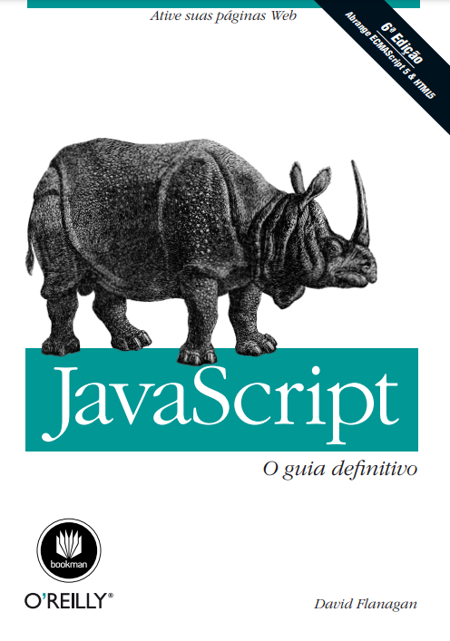

# Estudo_Livro_JavaScript_O_guia_definitivo
 ### Anotações e práticas referente ao livro!
 Tomara que o Adriano do futuro use isso!

***
## **Anotação**

"Este livro abrange a linguagem JavaScript e as APIs JavaScript implementadas pelos navegadores
Web. Eu o escrevi para os leitores com pelo menos alguma experiência prévia em programação
que queiram aprender JavaScript e também para programadores que já utilizam JavaScript, mas
querem aumentar seu conhecimento e realmente dominar a linguagem e a plataforma Web. Meu
objetivo com este livro é documentar de forma ampla e definitiva a linguagem e a plataforma JavaScript. Como resultado, ele é grande e detalhado. Contudo, espero que sua leitura cuidadosa seja
recompensadora e que o tempo investido nela seja facilmente recuperado em forma de uma maior
produtividade ao programar.   

Este livro está dividido em quatro partes. A Parte I abrange a linguagem JavaScript em si. A Parte II
abrange JavaScript do lado do cliente: as APIs JavaScript definidas por HTML5 e padrões relacionados e implementados pelos navegadores Web. A Parte III é a seção de referência da linguagem básica
e a Parte IV é a referência para JavaScript do lado do cliente. O Capítulo 1 inclui um esboço dos
capítulos das partes I e II.   

Esta 6ª edição do livro abrange ECMAScript 5 (a versão mais recente da linguagem básica) e
HTML5 (a versão mais recente da plataforma Web). Você vai encontrar material sobre ECMAScript
5 ao longo de toda a Parte I. O material novo sobre HTML5 aparece principalmente nos capítulos
do final da Parte II, mas também em alguns outros capítulos. Os capítulos totalmente novos desta
edição são: Capítulo 11, Subconjuntos e extensões de JavaScript; Capítulo 12, JavaScript do lado do
servidor; Capítulo 19, A biblioteca jQuery; e Capítulo 22, APIs de HTML5."
***
