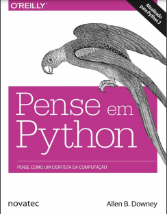
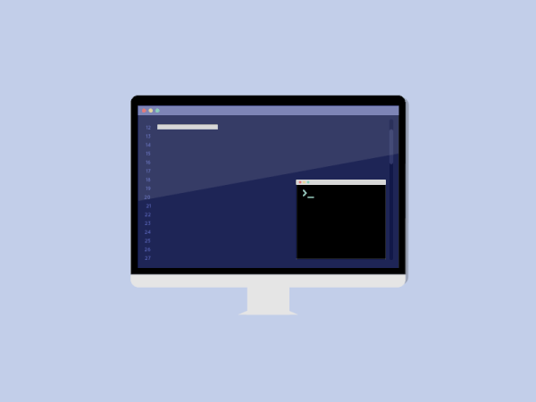

# Estudo Livro: Pense em Python
 ### Aplicando o que estou aprendendo lendo o livro: Pense em Python!

## Resumo de coisas importantes:

O objetivo desse livro é ensinar a pensar como um cientista da computação.

A habilidade mais importante de um cientista da computação é a __resolução__ __de__ __problemas__.   
Resolução de problemas significa a capadicade de formular problemas, pensar criativamente em soluções e expressar a solução de forma clara e precisa.  

Assim, o processo de aprender a programar é uma oportunidade exelente para exercitar a habilidade de resolver problemas.

———————————————————————————————————————————————————————————
## O que é um programa?

Um programa é uma sequência de instruções que especifica como executar uma opereção de computação.   
A operação de computação pode ser algo matemático, como solucionar um sistema de equações ou encontrar raízes de um polinômio, mas também pode ser uma operação de computação simbólica, com a busca ea substituição de textos em um documento; ou algo gráfico, como o processamento de uma imagem ou a reprodução de um vídeo.

Os detalhes parecem diferentes em linguagens diferentes, mas algumas instruções básicas aparecem em quase todas as linguagens:

_entrada_:   
— Receber dados do teclado, de um arquivo, da rede ou de algum outro dispositivo.

_saída_:   
— Exibir dados na tela, salvá-los em um arquivo, enviálos pela rede etc.

_matemática_:   
— Executar operações matemáticas básicas como adição e multiplicação.

_execução condicional_:   
— Verificar a existência de certas condições e executar o código adequado.

_repetição_:   
— Executar várias vezes alguma ação, normalmente com algumas variações.   

———————————————————————————————————————————————————————————

### __Acredite ou não, isto é basicamente tudo o que é preciso saber. Cada programa que você já usou, complicado ou não, é composto de instruções muito parecidas com essas. Podemos então chegar à conclusão de que programar é o processo de quebrar uma tarefa grande e complexa em subtarefas cada vez menores, até que estas sejam simples o suficiente para serem executadas por uma dessas instruções básicas.__

———————————————————————————————————————————————————————————
## Erros Em Python!

